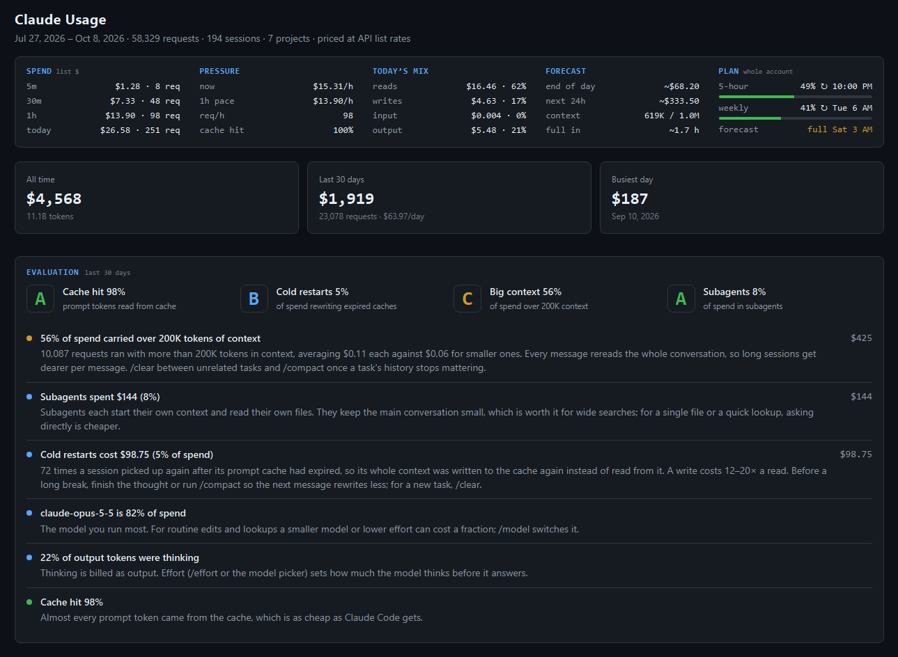
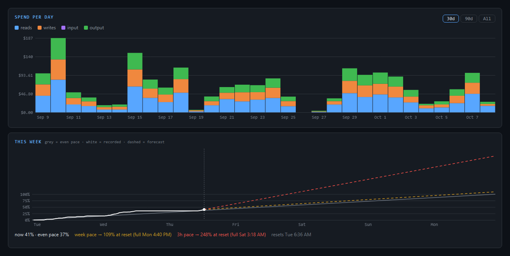
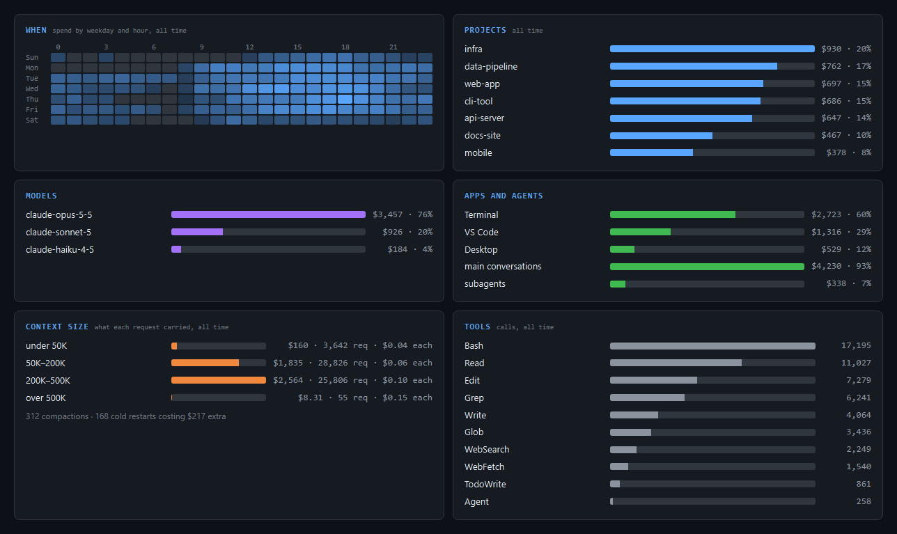
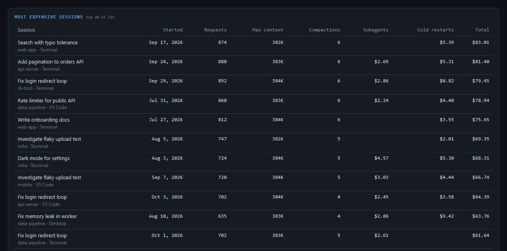
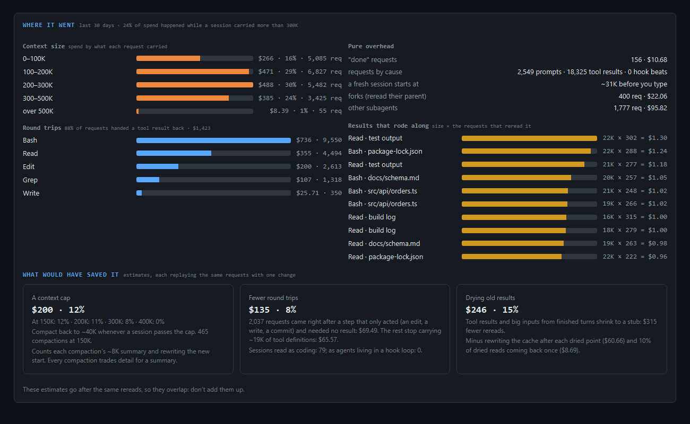

# Usage Panel

Two ways to see what your Claude Code usage costs:

- **`/meter`**: a pane inside Claude Code with your spend, pace, token mix, forecast, and plan week, live as you work.
- **`/meter web`**: a full report in your browser. It reads every Claude Code transcript on your computer, back to the oldest one Claude Code kept, and evaluates your habits: cache hits, cold restarts, context size, subagents, models, projects, the hours you work, your most expensive sessions, and the tools Claude calls most.









<sub>Screenshots use the made-up history from `--demo`. Run `npx github:Siigari/usage-panel --demo` to see it yourself.</sub>

## The /meter pane

Type `/meter` in a session for this pane beside the conversation:

```
SPEND list $                PRESSURE                   TODAY'S MIX                FORECAST                   PLAN whole account
5m       $1.19 · 10 req     now          $14.33/h      reads     $76.52 · 72%     end of day     ~$149.47    5-hour     12%  ↻ 11:20 PM
30m      $8.68 · 74 req     1h pace      $12.15/h      writes    $12.97 · 12%     next 24h       ~$291.55    ━━━━━━━━━━━━━━━━━━━━━━━━━━━
1h     $12.15 · 103 req     req/h             103      input      $7.39 · 7%      context      479K / 1M     weekly     10%  ↻ Thu 11 AM
today $105.64 · 1077 req    cache hit        100%      output     $8.76 · 8%      full in         ~5.7 h     ━━━━━━━━━━━━━━━━━━━━━━━━━━━
                                                                                                             forecast   full Sun 6 AM
■ reads  ■ writes  ■ input  ■ output  ─ context
[stacked bars: dollars per 5 minutes, with this session's context as a line]

THIS WEEK  grey = even pace · white = recorded · dashed = forecast · top = 100%
[the plan week from start to reset: even pace, what you've used, and where two paces land]
now 10%, 4 pts behind even pace
week pace → 18% at reset
3h pace → 140% at reset (full Sun 6 AM)
resets Thu 11 AM
```

## Install

You need Claude Code **2.1.287 or newer** (`claude --version`; `claude update` if older).

```
claude plugin marketplace add Siigari/usage-panel
claude plugin install usage-panel@siigari
```

Or from inside a session: `/plugin install usage-panel --marketplace Siigari/usage-panel`.

Restart Claude Code (or run `/reload-plugins`), then type **`/meter`** to open the pane. `/meter` again, or Esc, closes it.

## The full report

`/meter web` (or `npx github:Siigari/usage-panel` from any shell, no install) reads `~/.claude/projects/`, writes `~/.claude/usage-reader/report.html`, and opens it. It needs Node.js 18 or newer. `--demo` shows the report with a made-up history instead of yours.

The first run reads everything (about 20 seconds for 16 GB of transcripts); after that only the sessions that changed are reread. `npx github:Siigari/usage-panel --watch` keeps it fresh: it rescans every minute and the page reloads itself.

The report grades the last 30 days on four things and lists what stands out, most expensive first:

- **Cache hit**: how much of every prompt came from the cache (cheap) rather than being written fresh.
- **Cold restarts**: a session picked up after its cache expired (5 minutes or 1 hour, depending on the session), so its whole context was written again. The dollar figure is the extra over reading it.
- **Big context**: the share of spend on requests carrying over 200K tokens. Every message rereads the whole conversation, so long sessions cost more per message.
- **Subagents**: the share of spend in subagents, which each start their own context.

It also shows spend per day (stacked by reads, writes, input, and output), a weekday-by-hour heatmap, spend by project, model, and app, context size buckets, tool calls, and the 40 most expensive sessions.

The report makes no network call unless you ask it to. `--plan` adds your plan's live percent, read with the same account-usage call Claude Code's `/usage` screen makes and the login Claude Code saved on this computer. Without it, the plan comes from the readings the `/meter` pane already saved. The week chart's recorded line comes from readings the report and the `/meter` pane save. Its red 3h pace is measured from those readings once they cover 45 minutes of the last 3 hours; until then it is estimated from spend (the week's percent per list-price dollar so far, times what the last 3 hours cost) and labeled "est."

## Where it went, and what would have saved it

The report's second section goes past what you spent to why. It covers the last 30 days.



**Where it went** (facts, read straight from the transcripts):

- **Context size**: spend by how much each request carried, in bands up to over 500K. The headline is the share spent while a session carried more than 300K.
- **Round trips**: the share of requests that existed only to hand a tool's result back, by tool.
- **"Done" requests**: a tool result in, under 60 tokens out, and the turn ended. Each one reread the whole conversation to learn that a step worked.
- **Results that rode along**: the biggest tool results, times the number of later requests that reread them until a compaction or the end. "This 17K-token file read rode along 312 more requests: $1.07." File names show only in your own report.
- **A fresh session's start**: what a new session carries before you type (system prompt, tools, CLAUDE.md and skill listings together).
- **Stop-hook beats**: for agents that live in a hook loop, how many requests a Stop hook caused, and what it cost that a blocking hook's reason goes in twice.
- **Forks**: subagents that started by rereading their parent's whole context, apart from ordinary subagents.

**What would have saved it** (estimates; each replays the same requests with one change, and prints what it assumes):

- **A context cap**: compact back to about 40K whenever a session passed 150K, 200K, 300K or 400K. It counts each compaction's summary and rewriting the new start. Every compaction trades detail for a summary.
- **Fewer round trips**: drop the request that came right after a step that only acted (an edit, a write, a commit; for agents in a hook loop, also a message sent or a photo taken), and stop sending about 20K tokens of tool definitions with every request.
- **Drying old results**: tool results and big inputs from finished turns shrink to a stub. It counts rewriting the cache after each dried point, and 10% of dried reads coming back once.

These estimates go after the same rereads, so they overlap. The report never adds them up, and you shouldn't either.

### Before and after

```
npx github:Siigari/usage-panel --compare 2026-10-23T12:00 --project my-app
```

This splits one project's history (or all of it, without `--project`) at a moment and prints requests and dollars per active hour, the average reread, round-trip and "done" shares, and spend over 300K. Use it to see whether a change you made actually saved anything.

### A copy that's safe to send

```
npx github:Siigari/usage-panel --share
```

This also writes `report-share.html` and `report-share.md`, which hold numbers, model names and tool names only. Projects become Project A, B, C. There are no session titles, paths, commands or message text, and MCP tools keep only their tool name. Before writing them, a check scans both files for paths, your home folder, your project names and your session titles. If it finds any, it writes nothing and says so.

## Where it shows

The pane draws in **`claude` in a terminal** (VS Code's built-in terminal counts) and in the **Code tab of the Claude Desktop app**. The VS Code extension's chat panel doesn't draw mods, but sessions there still record their usage, so the numbers stay complete.

In a wide terminal the pane sits beside the conversation; in a narrow one it sits above the prompt. Ctrl+X then an arrow key resizes it.

## What the numbers are

- **SPEND**: what the requests in that window would cost at API list prices, and how many there were. "today" starts at your local midnight.
- **PRESSURE**: "now" is the last 5 minutes scaled to an hour; "1h pace" is the last hour; "cache hit" is the share of prompt tokens served from the cache in the last hour.
- **TODAY'S MIX**: today's dollars split into cache reads, cache writes, fresh input, and output.
- **FORECAST**: today plus the last hour's pace until midnight, the next 24 hours at that pace, this session's context, and how long until it fills at the last hour's growth.
- **PLAN**: your account's 5-hour and weekly percent and when each resets, as Claude Code itself reads them. "forecast" is when the week runs out at the last 3 hours' pace (or the week's average pace before there are 3 hours of readings).
- **THIS WEEK**: grey is even pace (0% at the start of the week to 100% at reset), white is what you've actually used, and the dashed lines carry the week's average pace (amber) and the last 3 hours' pace (red) out to the reset. Lines stop where they cross 100%.

## Good to know

- **Dollars are list prices, not a bill.** On a Pro or Max plan you don't pay per token; the dollars are a way to compare. Cache writes are counted at the 1-hour rate (2x input), which is what Claude Code uses on a subscription. A model the price table doesn't know is priced like the rest of its family.
- **The plan percent is the whole account**, the same number `/usage` shows. It only appears on a subscription, after the first reply in a session.
- **Spend counts sessions on this computer** that have the plugin on, from when you installed it. Other computers and claude.ai chats count toward your plan percent but not toward the dollars.
- **Nothing leaves your machine.** The pane keeps two days of requests and eight days of plan readings in Claude Code's plugin store (`~/.claude/plugins/store/`). The report is a file on your disk, and it makes no network call unless you pass `--plan`.
- **The estimates are estimates.** Token counts for content the transcripts don't count (tool results, inputs) use about 3.2 characters a token, and the classifiers that decide a step "only acted" are simple rules you can read in `reader/parse-file.js`.

## Where this is going

The meter is step one. [docs/VISION.md](docs/VISION.md) is where it's headed.

## Develop

```
claude --plugin-dir ./usage-panel        # load it from a checkout; edits reload on save
claude plugin validate --strict .        # what Claude Code reads from the hooks
claude plugin test                       # tests in tests/ (set SHOW = true in the test to print the charts)
node --test tests/reader.test.mjs        # the report's reader, on made-up transcripts
node reader/usage-reader.js --json       # the report's data, without the page
```

Built and tested with Claude Code 2.1.295.
